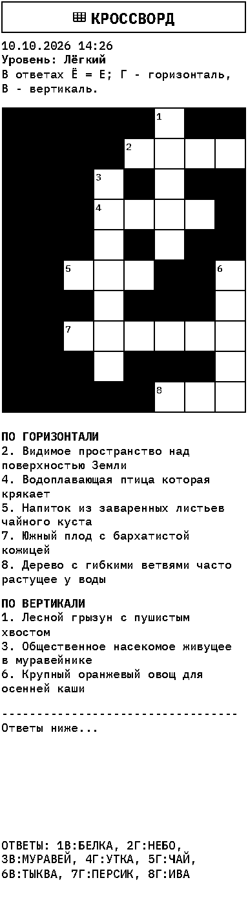

# VazyPrint: русские кроссворды

Первый этап русификации Paper Console. Генерация полностью локальная: внешние API,
аккаунты и интернет для кроссворда не нужны. Принтер для тестов не требуется.

## Настройка

В редакторе модуля Crossword выберите `Language / Язык → ru`. Для заголовка
чека задайте имя модуля «Кроссворд»: пользовательское имя имеет приоритет над
встроенным переводом. Количество слов — 3–18, уровни Easy / Medium / Hard
означают лёгкий / смешанный / сложный набор. Веб-интерфейс целиком пока не переведён.
Старые настройки без `language` продолжают использовать английский словарь.

Пример конфигурации модуля:

```json
{"language": "ru", "num_words": 10, "difficulty": "Easy"}
```

`app/data/crossword_words_ru.csv` содержит 442 слова (304 лёгких и 138 сложных) и
определения: 242 стартовые записи подготовлены для VazyPrint, ещё 200 предоставлены пользователем и отредактированы. См. [отчёт о новом пакете](russian-word-pack-2026-10-10.md).
Данные распространяются под MIT-лицензией этого репозитория. Набор требует
дальнейшей редакторской проверки; автоматические тесты не доказывают однозначность
всех определений. Сложность задана вручную и не учитывает возраст игрока.

Ответы приводятся к верхнему регистру, Ё заменяется на Е. В тексте вопросов
и печатных надписях Ё и Й сохраняются. Повторы ответов после нормализации
отбрасываются. Модуль поиска слов пока использует исходный английский словарь.

Дата на русском чеке имеет формат ДД.ММ.ГГГГ, время — 24-часовой формат
в настроенном часовом поясе устройства.

Ширина сетки — 8 клеток; высота подбирается генератором. Размещение всех
запрошенных слов не гарантируется. Решение печатается после отступа на том же
чеке. Драйвер сохраняет русские буквы в растровом тексте, поэтому кодовая
страница ESC/POS для кириллицы не нужна.

## Проверка без принтера (Linux / WSL)

```bash
python3 -m venv .venv
.venv/bin/pip install -r requirements.txt pytest fonttools
.venv/bin/python -m pytest testing/test_crossword.py testing/test_crossword_ru.py -q
.venv/bin/python testing/render_russian_crossword.py --output testing/artifacts/debug/crossword_ru.png
.venv/bin/python testing/console_raster_preview.py --image testing/artifacts/debug/crossword_ru.png --dots-width 384 --cols 96
```

Рендер использует настоящий драйвер растровой печати через штатный офлайн-захват
`testing/render_all_prints.py`, без обращения к физическому устройству.
Для воспроизводимости задаётся seed. Не используйте фиксированный seed в рабочем
модуле: там случайный выбор сохраняется.

Перед установкой на Raspberry Pi нужно отдельно проверить реальную печать:
шрифт, Ё/Й, читаемость мелких подсказок, поля, отрыв и длину чека.
Этот этап не обновляет устройство. Существующие USB-адаптация и привязка сервиса
к появлению принтера должны сохраняться при последующем развёртывании.

## Пример полного чека


